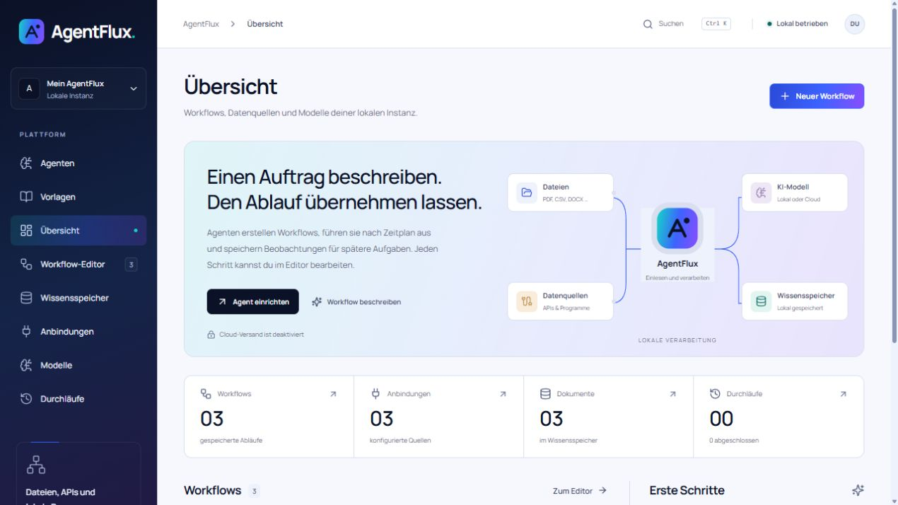
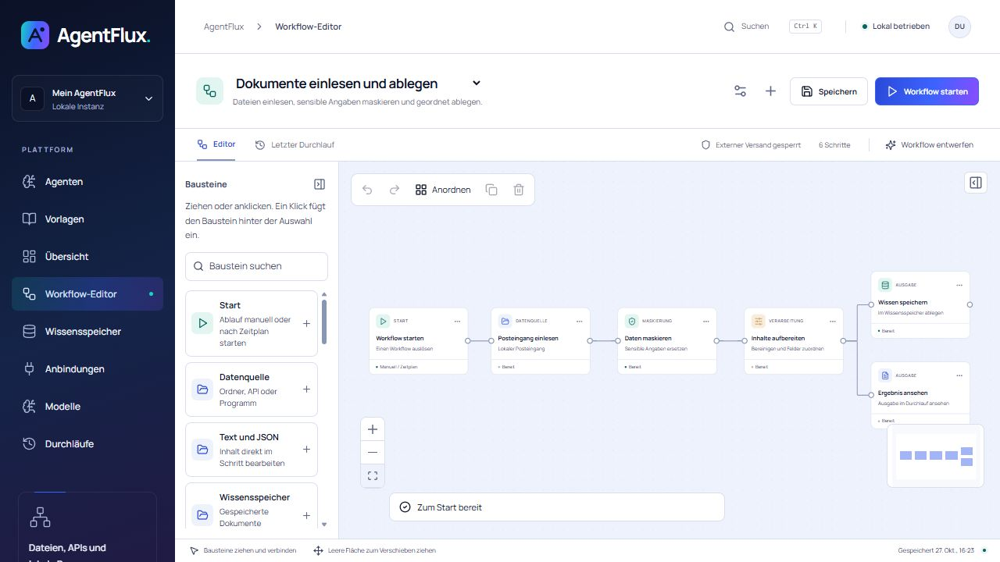
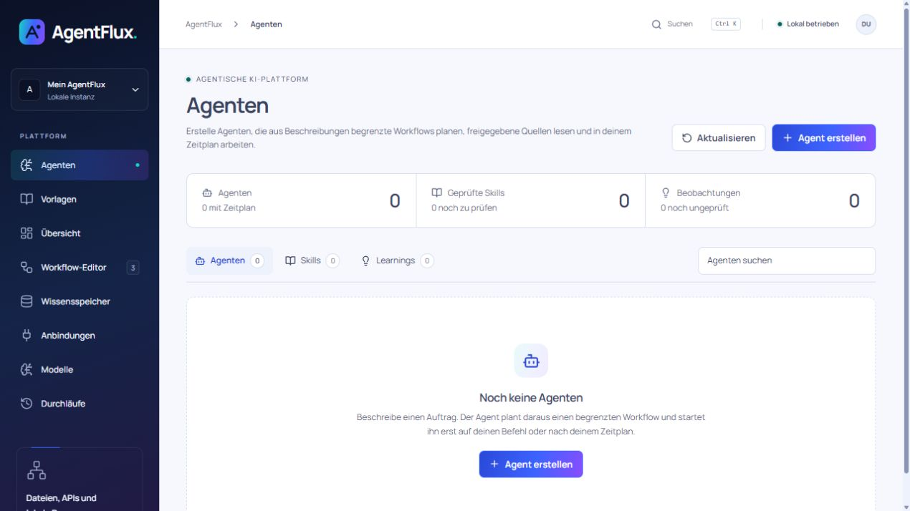
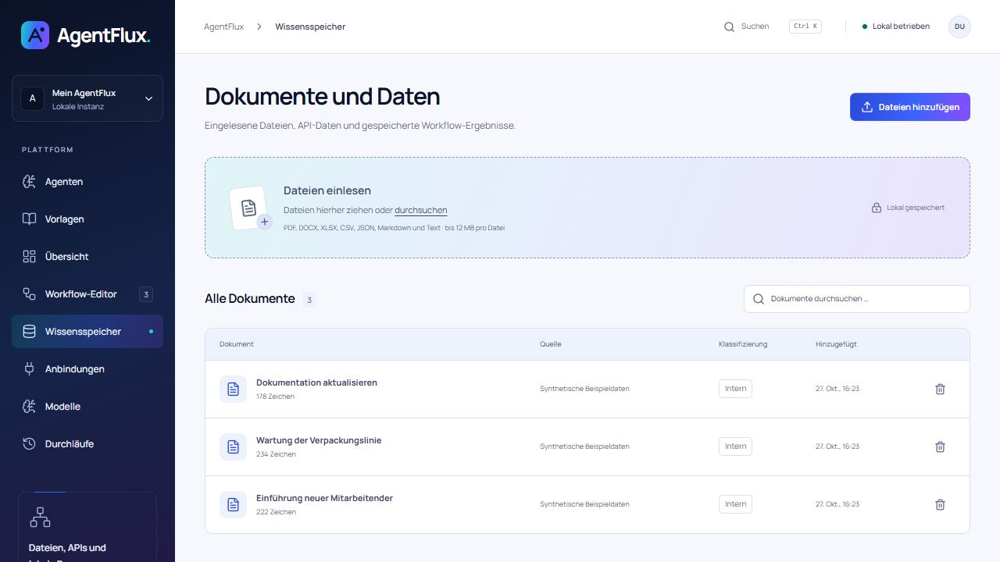

# AgentFlux

### Deine Daten. Deine Modelle. Deine Abläufe.

**Agentische KI-Plattform** für visuelle Workflows und selbstständig arbeitende Agenten. 
Dateien einlesen, Aufgaben automatisieren und Ergebnisse lokal behalten.

[**Docker-Release herunterladen**](https://github.com/davemessew/AgentFlux/releases/latest) · [Website](https://agentflux.cloud) · [Dokumentation](docs/installation.md) · [Problem melden](https://github.com/davemessew/AgentFlux/issues)

 

 

## Was du damit machen kannst

AgentFlux verbindet Dokumente, Datenquellen und Sprachmodelle in einem visuellen Ablauf. Du kannst jeden Schritt selbst zusammensetzen oder einen Agenten aus einer Aufgabenbeschreibung einen Workflow erstellen lassen. Die Anwendung läuft auf deinem Rechner oder Server, die Bedienung im Browser.

| | In AgentFlux |
| :--- | :--- |
| **Visuelle Workflows** | 17 vorkonfigurierte Bausteine, acht Vorlagen, Verzweigungen, Undo/Redo und JSON-Import/-Export. |
| **KI-Agenten** | Aufträge beschreiben, Quellen und Modell auswählen, manuell starten oder einen Zeitplan einrichten. |
| **Wissen und Learnings** | Dokumente lokal ablegen, Beobachtungen aus Durchläufen prüfen und Arbeitsanweisungen als Skills wiederverwenden. |
| **Eigene Modelle** | Ollama, LM Studio, vLLM und OpenAI-kompatible Endpunkte verbinden. |
| **Dateien und Anbindungen** | PDF, DOCX, XLSX, CSV, JSON und Text einlesen; Ordner, HTTP-Endpunkte und freigegebene Programme anbinden. |
| **Nachvollziehbare Durchläufe** | Schritte und Ergebnisse ansehen, laufende Aufgaben abbrechen, Ergebnisse als JSON oder CSV exportieren. |

## In wenigen Minuten mit Docker starten

Du brauchst **Docker mit Compose**. Das fertige Release enthält die Anwendung, die gebaute Oberfläche und Node.js. Lokal musst du weder Node noch pnpm installieren.

### Fertiges Image verwenden

Lade diese beiden Dateien aus dem [Release v0.2.0](https://github.com/davemessew/AgentFlux/releases/tag/v0.2.0) in denselben Ordner:

- [**agentflux-0.2.0-linux-amd64.tar.gz**](https://github.com/davemessew/AgentFlux/releases/download/v0.2.0/agentflux-0.2.0-linux-amd64.tar.gz): das fertige Docker-Image.
- [**compose.yaml**](https://github.com/davemessew/AgentFlux/releases/download/v0.2.0/compose.yaml): die Konfiguration zum Starten.

Öffne dort ein Terminal:

~~~sh
docker load -i agentflux-0.2.0-linux-amd64.tar.gz
docker compose up -d --wait
~~~

**Öffne [localhost:4310](http://localhost:4310).** Fertig.

Das vorgebaute Image ist für Linux/amd64. Unter Windows funktioniert es mit Docker Desktop im Modus für Linux-Container. Für andere Architekturen kannst du aus dem Quellcode bauen; sie wurden für dieses Release nicht geprüft.

<strong>Download direkt im Terminal</strong>

~~~sh
mkdir agentflux
cd agentflux
curl -fLO https://github.com/davemessew/AgentFlux/releases/download/v0.2.0/agentflux-0.2.0-linux-amd64.tar.gz
curl -fLO https://github.com/davemessew/AgentFlux/releases/download/v0.2.0/compose.yaml
docker load -i agentflux-0.2.0-linux-amd64.tar.gz
docker compose up -d --wait
~~~

Unter Windows PowerShell gegebenenfalls <code>curl.exe</code> statt <code>curl</code> verwenden. Prüfsummen und die ausführliche Anleitung liegen ebenfalls im [Release](https://github.com/davemessew/AgentFlux/releases/tag/v0.2.0).

<strong>Lieber selbst bauen?</strong>

~~~sh
git clone https://github.com/davemessew/AgentFlux.git
cd AgentFlux
docker compose up --build -d --wait
~~~

Die [Installation ohne Docker](docs/installation.md#ohne-docker-starten) ist ebenfalls dokumentiert.

## Ein Blick in die Anwendung

Die Screenshots zeigen den aktuellen Quellcode-Stand. Das veröffentlichte Docker-Release v0.2.0 verwendet noch das grüne Farbschema; das neue Design ist beim [Build aus dem Quellcode](#selbst-bauen) enthalten.

### Abläufe auf der Arbeitsfläche zusammensetzen

Quellen und Verarbeitungsschritte verbinden, Einstellungen direkt am Baustein bearbeiten und den Durchlauf verfolgen.

<table>
  <tr>
    <td width="50%"><strong>Agenten</strong> Aufträge, Modelle und wiederkehrende Aufgaben an einem Ort.</td>
    <td width="50%"><strong>Wissensspeicher</strong> Dokumente und aufbereitete Inhalte lokal durchsuchen.</td>
  </tr>
  <tr>
    <td></td>
    <td></td>
  </tr>
</table>

## Dein erster Workflow

1. Öffne **Vorlagen** und wähle **Daten bereinigen und speichern**. Die Vorlage verwendet synthetische Beispieldaten und braucht kein KI-Modell.
2. Starte den Workflow und öffne die Ergebnisse im Durchlauf.
3. Verbinde unter **Modelle** deinen Modellserver, wenn du Dokumente zusammenfassen oder Agenten nutzen möchtest.
4. Lege unter **Agenten** einen Auftrag an und wähle die erlaubten Quellen und das Modell.

Ein Modell ist nicht im Docker-Image enthalten. Du kannst einen vorhandenen lokalen Server oder einen externen Anbieter mit eigenen Zugangsdaten verwenden.

| Modellserver auf deinem Rechner | Basis-URL aus dem Container |
| :--- | :--- |
| Ollama | <code>http://host.docker.internal:11434</code> |
| LM Studio / OpenAI-kompatibel | <code>http://host.docker.internal:1234/v1</code> |
| vLLM | <code>http://host.docker.internal:8000/v1</code> |

Passe Port und Modell-ID an deinen Server an. Der Modellserver muss Verbindungen aus dem Container annehmen können.

## Betrieb und Daten

~~~sh
docker compose ps            # Status und Healthcheck
docker compose logs -f       # Serverausgabe ansehen
docker compose stop          # Anhalten
docker compose up -d --wait  # Wieder starten
~~~

Workflows, Dokumente, Zugangsdaten und Laufprotokolle bleiben im benannten Volume <code>agentflux-data</code>. Ein Austausch des Containers löscht sie nicht. Sichere das vollständige Volume einschliesslich <code>.vault-key</code>; <code>docker compose down -v</code> löscht das Volume.

> [!IMPORTANT]
> Die mitgelieferte Konfiguration bindet Port 4310 an localhost. AgentFlux hat keine Anmeldung und ist als Einzelbenutzerinstanz ausgelegt. Für gemeinsam oder öffentlich erreichbaren Betrieb brauchst du eine vorgeschaltete Zugangskontrolle und eine passende Netzwerkkonfiguration.

Cloud-Modellaufrufe und externe HTTP-POST-Schritte brauchen Freigaben in den Einstellungen und im Workflow. HTTP-GET-Anfragen können Angaben in URL und Headern übertragen. Die optionale Maskierung arbeitet mit Regeln und kann sensible Angaben übersehen. Details stehen in der [Installationsanleitung](docs/installation.md#daten-und-grenzen) und den [Betriebshinweisen](docs/operations.md).

## Dokumentation und Entwicklung

| Einstieg | Inhalt |
| :--- | :--- |
| [Docker-Release](https://github.com/davemessew/AgentFlux/releases/latest) | Fertiges Image, Compose-Datei, Quellcode und SHA-256-Prüfsummen |
| [Release installieren](docs/docker-release.md) | Download, Überprüfung, Start und Update |
| [Installation und Modelle](docs/installation.md) | Docker, native Installation und Modellanbindung |
| [Workflows und Agenten](docs/workflows.md) | Editor, Bausteine, Vorlagen, Learnings und Skills |
| [Betrieb und Konfiguration](docs/operations.md) | Umgebungsvariablen, Importordner, Sicherung und Programme |

~~~text
src/          Web-Oberfläche und visueller Editor
server/       API, Agenten, Ausführung und SQLite-Speicherung
shared/       Workflow-Regeln und Vorlagen
examples/     Beispiel für einen lokalen Programm-Export
scripts/      Docker-Release prüfen
docs/         Bedienung, Betrieb und Screenshots
website/      Projektwebsite
~~~

Für die lokale Entwicklung: Node.js 24+, pnpm 11.25.0, <code>pnpm install --frozen-lockfile</code>, danach <code>pnpm dev</code>.

Den Docker-Test nach einem Build ausführen:

~~~sh
docker build -t agentflux:0.2.0 .
node scripts/smoke-docker.mjs agentflux:0.2.0
~~~

Der Test verwendet einen eigenen Container mit eigenem Volume. Er prüft die API, die gebaute Oberfläche, einen Beispieldurchlauf und den Datenerhalt beim Ersetzen des Containers.

## Lizenz

[Apache License 2.0](LICENSE). Mitgelieferte Abhängigkeiten und Schriftarten behalten ihre jeweiligen Lizenzen.

 

[Release herunterladen](https://github.com/davemessew/AgentFlux/releases/latest) · [Website besuchen](https://agentflux.cloud) · [Issue öffnen](https://github.com/davemessew/AgentFlux/issues)

